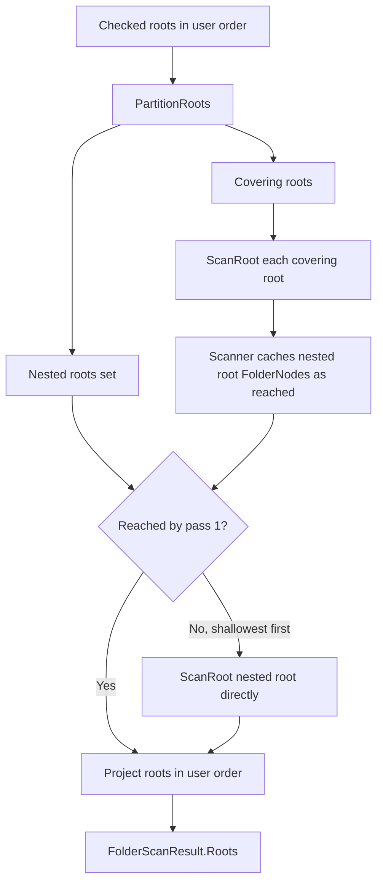

# Implementation Plan: Unmerged Nested Root Folders (Approach B)

## Overview
Display every checked root folder as its own top-level node in the `TreeView`, including roots nested inside other roots, while the parent root keeps its full hierarchy (Inclusive / Mirrored model). Covering roots are scanned once; each nested root's `FolderNode` is built once during that pass. The parent's tree holds a relabelled `with` copy of that node, which shares the same `Children` list and `Files` array, so the scanned data is never duplicated. Nested roots the covering pass never reached (System-attribute ancestor, link/junction ancestor, unlistable ancestor, missing covering root) are scanned directly as a fallback, so an accessible nested root is never silently dropped.

> [!IMPORTANT]
> **Code Documentation Requirement:** Any new or updated functions, methods, records, or classes must include a single-line, information-dense `<summary>` XML doc comment describing its (updated) function, matching the established codebase convention.



---

## Proposed Changes

### 1. `Random File Select/FolderTreeBuilder.cs`

#### A. Replace `RemoveNestedRoots` with `PartitionRoots`
`public static (IReadOnlyList<string> Ordered, IReadOnlyList<string> Covering, HashSet<string> Nested) PartitionRoots(IEnumerable<string> roots)`
- Apply `Path.TrimEndingDirectorySeparator` to each input (drive/UNC roots such as `C:\` are kept as-is). `RootFolderCollection` already does this, but `PartitionRoots` and `Scan` are public, and a trailing separator would make the cache lookup miss `DirectoryInfo.FullName` and double-scan the nested root.
- Drop exact duplicates (OrdinalIgnoreCase), keeping the first occurrence; `Ordered` is the remaining list in input order.
- `Covering`: entries of `Ordered` not `IsUnder` any other entry (input order).
- `Nested`: the rest, as a `HashSet<string>` with `StringComparer.OrdinalIgnoreCase`.
- Inputs are otherwise assumed to be full paths (`Path.GetFullPath`), as `RootFolderCollection` guarantees.

#### B. Scanner: one dictionary for reached and cached nested roots
- Add `HashSet<string> nestedRoots` to the `Scanner` primary constructor, plus a single dictionary. A key that is present means the nested root was reached; a `null` value means it was reached but skipped (link, inaccessible, or missing listing):
  ```csharp
  private readonly Dictionary<string, FolderNode?> _nestedRootNodes = new(nestedRoots.Count, StringComparer.OrdinalIgnoreCase);
  ```
- Accessors (add `using System.Diagnostics.CodeAnalysis;`):
  ```csharp
  public bool HasUnreachedNestedRoots => _nestedRootNodes.Count < nestedRoots.Count;
  public bool WasReached(string path) => _nestedRootNodes.ContainsKey(path);
  public bool TryGetNestedRootNode(string path, [NotNullWhen(true)] out FolderNode? node) =>
      _nestedRootNodes.TryGetValue(path, out node) && node is not null;
  ```
- In the `ScanDirectory` subdirectory loop, look up the set once per folder, and only while some nested root is still unreached. That means zero lookups when there are no nested roots, or once all of them have been reached. Mark the folder as reached right after `Visit(sub.FullName)`, before the `IsLink` check, so a nested root skipped as a link or as inaccessible is counted once and never retried:
  ```csharp
  Visit(sub.FullName);

  bool isNestedRoot = HasUnreachedNestedRoots && nestedRoots.Contains(sub.FullName);
  if (isNestedRoot)
      _nestedRootNodes[sub.FullName] = null;

  // existing IsLink try/catch unchanged

  DirectoryScan? child = ScanDirectory(sub);
  if (child is null)
      continue;

  FolderNode? nestedNode = null;
  if (isNestedRoot)
  {
      nestedNode = Wrap(sub.FullName, sub.FullName, child);
      _nestedRootNodes[sub.FullName] = nestedNode;
  }

  if (child.Files.Count > 0)
      nodes.Add(nestedNode ?? Wrap(sub.FullName, sub.Name, child));
  else
      nodes.AddRange(child.Nodes);
  ```
  - The parent's tree ends up with a different `FolderNode` instance. The nearest wrapped ancestor's `Wrap` relabels every child with `child with { DisplayName = Path.GetRelativePath(...) }`, which creates a shallow copy that shares `Children` and `Files` with the cached top-level node. So the full-path label never leaks into the parent's tree.
  - A nested root with no matching files of its own is still cached, so it appears as an empty or children-only top-level node, consistent with `Scan_rootWithoutMatches_stillShownButNotCounted`. Its parent attaches the nested root's descendants directly (`AddRange(child.Nodes)`), relabelled relative to the parent.

#### C. Keep a single `Wrap` helper (no `BuildNode`)
- Each folder is wrapped at most once (nested roots via the cache above, the rest as today), so `Wrap` can keep its `MatchingFolderCount++` and no side-effect-free split is needed. No second sort or `ImmutableArray` copy happens.
- Update the `Wrap` summary to note that the node may be cached as a top-level nested root.

#### D. Orchestrate in `FolderTreeBuilder.Scan`
```csharp
var (ordered, covering, nested) = PartitionRoots(roots);
var scanner = new Scanner(filter, nested, cancellationToken, progress);
var scanned = new Dictionary<string, FolderNode>(StringComparer.OrdinalIgnoreCase);

foreach (string root in covering)
    if (scanner.ScanRoot(root) is { } node)
        scanned[root] = node;

foreach (string root in nested.OrderBy(p => p.Length))
    if (!scanner.WasReached(root) && scanner.ScanRoot(root) is { } node)
        scanned[root] = node;

var rootNodes = new List<FolderNode>(ordered.Count);
foreach (string root in ordered)
    if (scanned.TryGetValue(root, out FolderNode? node) || scanner.TryGetNestedRootNode(root, out node))
        rootNodes.Add(node);
```
- Fallback ordering: ascending path length guarantees an ancestor nested root is scanned before its descendants, so a deeper nested root reached by an earlier fallback is cached (and `WasReached`) and never scanned twice.
- No double counting: an unreached nested root's subtree was never visited (the only path into it is through the root itself), so the fallback adds no duplicate `ProcessedCount`/`MatchingFolderCount`. Reached-but-skipped nested roots (link, inaccessible listing) are not retried, so their skip is counted once and they are omitted from `result.Roots`, same as an equivalent covering root.
- A nested root whose covering root is missing is scanned by the fallback and counted as its own `Missing` skip if it is also missing; this is intended (two configured roots, two skips).
- Update the `Scan` summary (no longer "nested ones removed").

### 2. `FolderScanResult` and `FolderTreeStatusFormatter` (same file)
- Remove `MergedRootCount` from `FolderScanResult`.
- Keep `RootsScanned` (no rename), set to `rootNodes.Count`: the number of shown root nodes, which is what users understand when they read "N roots scanned".
- `FormatCompleted`: delete the `nested roots merged` branch; the zero-match message is unchanged.
- `FormatTooltip`: delete the `Nested roots merged:` line; `Roots scanned:` is unchanged.

### 3. `Random File Select/FoldersTreeController.cs`
- No code changes. `Populate` already creates one top-level `TreeNode` per `result.Roots` item; nested roots now appear as additional top-level nodes.
- The two views of a nested root carry different `FolderNode` instances in `Tag` that share `Files` and `Children`, so activation lists the same files. Only the label differs: the full path at the top level, the relative name inside the parent. That label also appears in the status strip text.
- Each nested root's subtree is turned into `TreeNode`s twice (once per view). This is inherent to showing it twice; the scanned data itself is not duplicated.

---

## Tests (`tests/Random File Select.Tests/FoldersTreeTests.cs`)

Update:
- `RemoveNestedRoots_dropsNested_keepsOrder_countsMerged` -> `PartitionRoots_dedupesExact_splitsCoveringAndNested_keepsOrder`: same input plus an exact duplicate (different case) and an entry with a trailing separator; assert `Ordered`, `Covering`, and `Nested` contents (trailing separator trimmed).
- `Scan_nestedRoot_scannedOnce_countsNotInflated`: assert two roots (parent then nested, in input order), `MatchingFolderCount == 1`, `ProcessedCount == 2`, nested root `SubtreeFileCount == 1`. Assert sharing with `Assert.Same(nestedTop.Children, parentChild.Children)` and `Assert.True(nestedTop.Files == parentChild.Files)` (`ImmutableArray<T>` `==` compares the underlying array reference), not `Assert.Same` on the nodes themselves, which are distinct instances.
- `FormatCompleted_mergedRoots`: remove (or replace with an assertion that no "merged" text appears).
- `FormatTooltip_containsBreakdown`: drop the `Nested roots merged` assertion.
- `Result(...)` test helper: remove the `merged` parameter.

Add:
- Child root listed before parent root: `result.Roots` follows input order.
- Grandchildren (`A`, `A\B`, `A\B\C` all checked): three roots, `ProcessedCount` equals the physical folder count.
- Empty nested root (no matching files, no matching descendants) still appears in `result.Roots` with `SubtreeFileCount == 0`.
- Nested root with no own files but a matching descendant (`A` and `A\B` checked, file in `A\B\C`): top-level `A\B` has a single child labelled `C`; `A` has a single child labelled `B\C` (no `B` node); `MatchingFolderCount == 1`.
- Nested root `DisplayName` equals its full path; its children's `DisplayName` values are relative to the nested root (not the covering root).
- Trailing separator: roots `A` and `A\B\` (with a file in `B`); assert two roots and `ProcessedCount == 2` (no fallback rescan).
- Fallback, System attribute: `A\Sys` marked `FileAttributes.System | FileAttributes.Directory`, nested root `A\Sys\N` with a matching file; checked roots `A`, `A\Sys\N`. Assert both roots shown, `N` has its file, `A` does not contain it.
- Fallback with nested grandchildren: under System folder `A\Sys`, check `A`, `A\Sys\B`, and `A\Sys\B\C`, each with a matching file. Assert three roots, and that `ProcessedCount` and `MatchingFolderCount` equal the physical counts (`C` is reached during `B`'s fallback, not scanned again).
- Fallback, link ancestor: `A\link` is a symbolic link to an outside target, nested root `A\link\N` checked (use the existing `Directory.CreateSymbolicLink` try/return pattern). Assert `N` is shown via the fallback and `Skipped.Link == 1`.
- Reached-but-skipped nested root not retried: nested root `A\L` is itself a symbolic link; assert it is absent from `result.Roots` and `Skipped.Link == 1` (not 2).
- Missing covering root: checked roots `missing`, `missing\sub`; assert no roots and `Skipped.Missing == 2`.

---

## Edge Cases Handled

1. **Root order independence:** covering roots are scanned first, then all roots are projected in input order.
2. **Grandchildren:** `A\B` and `A\B\C` are both captured during `A`'s pass; each folder is wrapped once.
3. **Unreachable but accessible nested roots:** System-attribute, link/junction, or unlistable ancestors, and missing covering roots, are covered by the shallowest-first fallback scan.
4. **Reached-but-skipped nested roots:** not retried; counted once and omitted, same as a covering root that `ScanRoot` skips.
5. **Shared scanned data:** a nested root's `Files` and `Children` are the same instances in both places. Only the outer `FolderNode` is a relabelled shallow copy, so no file metadata or subtree is duplicated.
6. **Trailing separators:** trimmed in `PartitionRoots`, so cache lookups always match `DirectoryInfo.FullName`.
